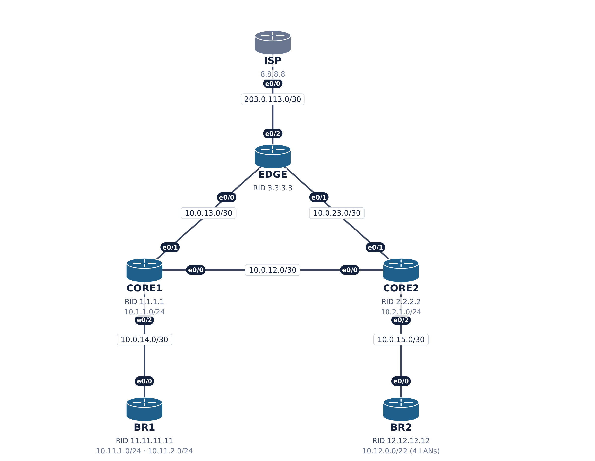
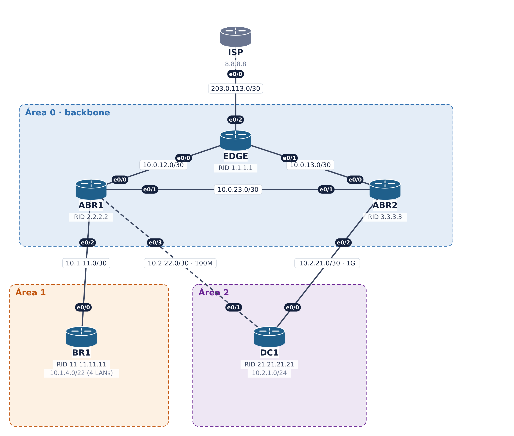

# Troubleshooting EIGRP e OSPF — CCNP ENARSI v9

Material de uma aula de 3 horas (1h30 de EIGRP + 1h30 de OSPF) baseada nos módulos 3 e 6 do CCNP ENARSI v9.
A aula começa com slides curtos e segue com uma **demo ao vivo no CML2**: cada problema é tratado como um *ticket* de suporte, do sintoma à correção.

São **4 labs com defeitos plantados** e os **4 labs "solução"** correspondentes. Cada lab tem 6 nós IOL-XE, pilha dupla (IPv4 + IPv6) e foi testado de ponta a ponta.

> Material preparado por Moises para a **ABRedes — Academia Brasileira de Redes**.

---

## Conteúdo

| Pasta / arquivo | O que é |
|---|---|
| [`apresentacoes/`](apresentacoes/) | Slides em PDF: [EIGRP](<apresentacoes/Troubleshooting EIGRP — ENARSI.pdf>) e [OSPF](<apresentacoes/Troubleshooting OSPF — ENARSI.pdf>) (16 slides cada) |
| [`Lab_EIGRP-A.md`](Lab_EIGRP-A.md) · [`Lab_EIGRP-B.md`](Lab_EIGRP-B.md) | Roteiros do instrutor dos labs EIGRP |
| [`Lab_OSPF-A.md`](Lab_OSPF-A.md) · [`Lab_OSPF-B.md`](Lab_OSPF-B.md) | Roteiros do instrutor dos labs OSPF |
| [`PLANO_Aula_Tshoot_EIGRP_OSPF.md`](PLANO_Aula_Tshoot_EIGRP_OSPF.md) | Planejamento da aula, tempos e decisões |
| [`configs/`](configs/) | **Configurações IOS de todos os nós** (com problemas e solução) para montar no EVE-NG, PNETLab, GNS3 ou equipamento real: um `.md` por topologia ([EIGRP-A](configs/EIGRP-A.md) · [EIGRP-B](configs/EIGRP-B.md) · [OSPF-A](configs/OSPF-A.md) · [OSPF-B](configs/OSPF-B.md)) e um `.txt` por nó |
| [`topologias_cml/`](topologias_cml/) | 8 topologias para importar no CML2 (`*_PROBLEMAS` e `*_SOLUCAO`) |
| [`topologias_drawio/`](topologias_drawio/) | 8 diagramas editáveis no draw.io |
| [`topologias_png/`](topologias_png/) | 8 figuras. As versões `PROBLEMAS` marcam em vermelho onde estão os defeitos |

Cada roteiro `Lab_*.md` traz, para cada ticket:

1. O chamado do usuário
2. Os comandos `show` para ver o **sintoma**, **isolar** e achar a **causa**, com a saída esperada
3. A **correção**
4. A **verificação**
5. A lição do ticket
6. O bloco para **quebrar de novo**, que reaplica o defeito

Os roteiros também trazem as configurações iniciais comentadas, com cada defeito marcado com `! >>>>> DEFEITO`, e as configurações finais corrigidas.

---

## Os labs

| Lab | Tema | Tickets | Topologia |
|---|---|---|---|
| **EIGRP-A** | Vizinhança | A1 autenticação (key-string) · A2 passive-interface · A3 AS diferente · A4 K-values | CORE1, CORE2, BR1, BR2, BR3, DC1 |
| **EIGRP-B** | Rotas | B1 stub receive-only · B2 prefix-list sem permit · B3 sumário 0.0.0.0/0 · B4 Router-ID duplicado | ISP, EDGE, CORE1, CORE2, BR1, BR2 |
| **OSPF-A** | Adjacência | A1 hello/dead · A2 área diferente · A3 MTU (EXSTART) · A4 flag stub | CORE, ABR1, ABR2, BR1, BR2, DC1 |
| **OSPF-B** | Rotas e caminho | B1 network type (FULL sem rotas) · B2 `area range not-advertise` · B3 sem `default-information originate` · B4 reference-bandwidth | ISP, EDGE, ABR1, ABR2, BR1, DC1 |

Cada lab tem também um ticket **bônus em IPv6**, que começa corrigido; o roteiro traz o bloco para quebrar. Os bônus **não foram testados** no lab.

### EIGRP-A — Vizinhança

### EIGRP-B — Rotas

### OSPF-A — Adjacência

### OSPF-B — Rotas e caminho

---

## Como usar

### Requisitos
- Cisco Modeling Labs (CML2) com a imagem **IOL-XE** (testado com 17.18.2)
- 6 nós por lab. Com a licença de **20 nós**, ligue no máximo 2 labs por vez

### Passo a passo
1. No CML2, importe os arquivos de `topologias_cml/`. Os arquivos `*_PROBLEMAS.yaml` já sobem com os defeitos.
2. Ligue os dois labs do bloco (EIGRP-A + EIGRP-B, ou OSPF-A + OSPF-B) e espere convergir. O OSPF leva cerca de 40 segundos.
3. Siga o roteiro `Lab_*.md` correspondente, um ticket por vez.
4. Para recomeçar: *Stop → Wipe → Start* no CML2, ou aplique os blocos **Quebrar** dos roteiros.

### Sem CML2? EVE-NG, PNETLab ou GNS3
Monte a topologia com o cabeamento de [`configs/`](configs/README.md) e cole em cada nó a configuração de `configs/<LAB>/problemas/` (para treinar) ou `configs/<LAB>/solucao/` (para ver o lab funcionando). Com imagens IOL, os nomes de interface (`Ethernet0/x`) já batem. Com IOSv ou CSR, veja a tabela de conversão em [`configs/README.md`](configs/README.md).

### Ordem recomendada dos tickets
| Lab | Ordem | Por quê |
|---|---|---|
| EIGRP-A | A1 → A2 → A3 → A4 | Tickets independentes |
| EIGRP-B | B1 → B2 → B3 → B4 | O B3 esconde o B4 |
| OSPF-A | A1 → A3 → A2 → A4 | O A3 isola a área 1 do backbone |
| OSPF-B | B1 → B2 → B3 → B4 | O B1 esconde o B2 |

### Pilha dupla como recurso didático
Nos labs de vizinhança e adjacência, os defeitos ficam **só no IPv4** e o IPv6 continua funcionando. Se o IPv6 passa e o IPv4 não, o meio físico está bom e o problema está no address-family ou no processo IPv4.

---

## Convenções de endereçamento

- Interfaces IOL-XE: `Ethernet0/x`
- Enlaces: `/30` em `10.x.y.0` e `/64` em `2001:db8:acad:<xy>::`
- Loopback0 de cada nó: `10.255.255.n/32` e `2001:db8:acad:ffff::n/128`
- LANs simuladas em loopbacks
- ISP: `203.0.113.0/30` e `8.8.8.8` / `2001:4860:4860::8888`
- Console sem senha

---

Material didático para uso em sala de aula. As topologias e configurações foram criadas para esta aula e não fazem parte do material oficial da Cisco Networking Academy.
