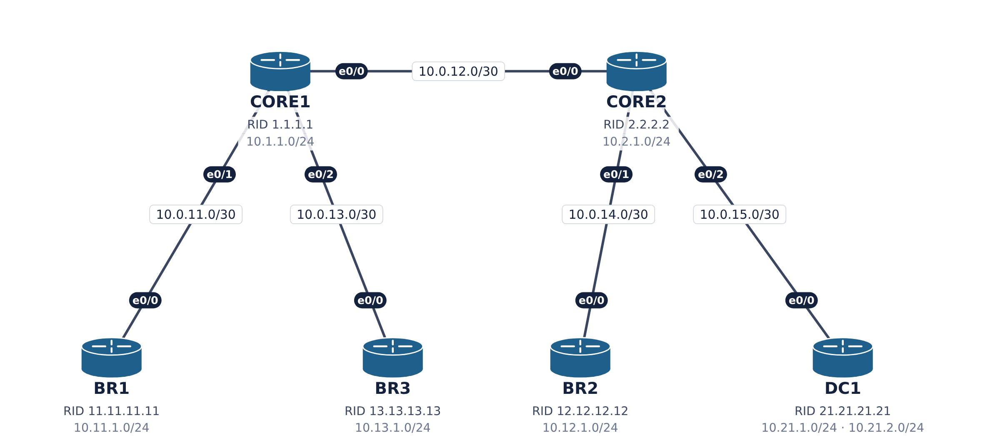

# Configurações IOS — Lab EIGRP-A

Lab EIGRP-A — Vizinhança (adjacência)

Configurações completas de todos os nós, testadas no CML2 com IOL-XE 17.18. Para aplicar, use `configure terminal` e cole o bloco do nó.
Para EVE-NG, PNETLab ou GNS3, veja a tabela de interfaces em [`README.md`](README.md).



## Cabeamento

| Lado A | Lado B | IPv4 | IPv6 |
|---|---|---|---|
| CORE1 e0/0 | CORE2 e0/0 | 10.0.12.0/30 | 2001:db8:acad:12::/64 |
| CORE1 e0/1 | BR1 e0/0 | 10.0.11.0/30 | 2001:db8:acad:11::/64 |
| CORE1 e0/2 | BR3 e0/0 | 10.0.13.0/30 | 2001:db8:acad:13::/64 |
| CORE2 e0/1 | BR2 e0/0 | 10.0.14.0/30 | 2001:db8:acad:14::/64 |
| CORE2 e0/2 | DC1 e0/0 | 10.0.15.0/30 | 2001:db8:acad:15::/64 |

## Defeitos plantados

| Ticket | Problema | Onde |
|---|---|---|
| A1 | Autenticação: key-string diferente | BR1 |
| A2 | Passive-interface no uplink | BR2 |
| A3 | Número de AS diferente | BR3 |
| A4 | K-values diferentes | DC1 |

Índice: [Com problemas](#1-configurações-com-problemas) · [Solução](#2-configurações-da-solução)

## 1. Configurações com problemas

Cada defeito está marcado com `! >>>>> DEFEITO`.

### BR1 (com problemas)

```
! ==========================================================
! Lab EIGRP-A - BR1 - COM OS DEFEITOS PLANTADOS (linhas '! >>>>> DEFEITO' indicam cada um)
! Plataforma testada: Cisco IOL-XE 17.18 (CML2). Interfaces Ethernet0/x.
! Uso: entre em 'configure terminal' e cole o bloco abaixo.
! ==========================================================
! --- Nome do equipamento
hostname BR1
no ip domain lookup
! --- Habilita roteamento IPv6 (pilha dupla)
ipv6 unicast-routing
line con 0
 exec-timeout 0 0
 logging synchronous
key chain EIGRP-KEYS
 key 1
! >>>>> DEFEITO A1: key-string diferente do CORE1 (CISCO123)
  key-string Cisco123
! --- Loopback0: endereco de gerencia / identificacao
interface Loopback0
 ip address 10.255.255.3 255.255.255.255
 ipv6 address 2001:db8:acad:ffff::3/128
 no shutdown
! --- LAN simulada (loopback)
interface Loopback1
 ip address 10.11.1.1 255.255.255.0
 ipv6 address 2001:db8:acad:1101::1/64
 no shutdown
interface Ethernet0/0
 description Link para CORE1
 ip address 10.0.11.2 255.255.255.252
 ipv6 address 2001:db8:acad:011::2/64
 no shutdown
! --- EIGRP named mode - processo EMPRESA
router eigrp EMPRESA
 address-family ipv4 unicast autonomous-system 100
  af-interface Ethernet0/0
   authentication mode md5
   authentication key-chain EIGRP-KEYS
  exit-af-interface
  network 10.0.0.0
  eigrp router-id 11.11.11.11
 exit-address-family
 address-family ipv6 unicast autonomous-system 100
  eigrp router-id 11.11.11.11
 exit-address-family
end
```

### BR2 (com problemas)

```
! ==========================================================
! Lab EIGRP-A - BR2 - COM OS DEFEITOS PLANTADOS (linhas '! >>>>> DEFEITO' indicam cada um)
! Plataforma testada: Cisco IOL-XE 17.18 (CML2). Interfaces Ethernet0/x.
! Uso: entre em 'configure terminal' e cole o bloco abaixo.
! ==========================================================
! --- Nome do equipamento
hostname BR2
no ip domain lookup
! --- Habilita roteamento IPv6 (pilha dupla)
ipv6 unicast-routing
line con 0
 exec-timeout 0 0
 logging synchronous
! --- Loopback0: endereco de gerencia / identificacao
interface Loopback0
 ip address 10.255.255.5 255.255.255.255
 ipv6 address 2001:db8:acad:ffff::5/128
 no shutdown
! --- LAN simulada (loopback)
interface Loopback1
 ip address 10.12.1.1 255.255.255.0
 ipv6 address 2001:db8:acad:1201::1/64
 no shutdown
interface Ethernet0/0
 description Link para CORE2
 ip address 10.0.14.2 255.255.255.252
 ipv6 address 2001:db8:acad:014::2/64
 no shutdown
! --- EIGRP named mode - processo EMPRESA
router eigrp EMPRESA
 address-family ipv4 unicast autonomous-system 100
  af-interface Ethernet0/0
! >>>>> DEFEITO A2: uplink passivo -> nao envia hellos IPv4
   passive-interface
  exit-af-interface
  network 10.0.0.0
  eigrp router-id 12.12.12.12
 exit-address-family
 address-family ipv6 unicast autonomous-system 100
  eigrp router-id 12.12.12.12
 exit-address-family
end
```

### BR3 (com problemas)

```
! ==========================================================
! Lab EIGRP-A - BR3 - COM OS DEFEITOS PLANTADOS (linhas '! >>>>> DEFEITO' indicam cada um)
! Plataforma testada: Cisco IOL-XE 17.18 (CML2). Interfaces Ethernet0/x.
! Uso: entre em 'configure terminal' e cole o bloco abaixo.
! ==========================================================
! --- Nome do equipamento
hostname BR3
no ip domain lookup
! --- Habilita roteamento IPv6 (pilha dupla)
ipv6 unicast-routing
line con 0
 exec-timeout 0 0
 logging synchronous
! --- Loopback0: endereco de gerencia / identificacao
interface Loopback0
 ip address 10.255.255.4 255.255.255.255
 ipv6 address 2001:db8:acad:ffff::4/128
 no shutdown
! --- LAN simulada (loopback)
interface Loopback1
 ip address 10.13.1.1 255.255.255.0
 ipv6 address 2001:db8:acad:1301::1/64
 no shutdown
interface Ethernet0/0
 description Link para CORE1
 ip address 10.0.13.2 255.255.255.252
 ipv6 address 2001:db8:acad:013::2/64
 no shutdown
! --- EIGRP named mode - processo EMPRESA
router eigrp EMPRESA
! >>>>> DEFEITO A3: AS 1000 no AF IPv4 (dominio usa AS 100)
 address-family ipv4 unicast autonomous-system 1000
  network 10.0.0.0
  eigrp router-id 13.13.13.13
 exit-address-family
 address-family ipv6 unicast autonomous-system 100
  eigrp router-id 13.13.13.13
 exit-address-family
end
```

### CORE1 (com problemas)

```
! ==========================================================
! Lab EIGRP-A - CORE1 - COM OS DEFEITOS PLANTADOS (linhas '! >>>>> DEFEITO' indicam cada um)
! Plataforma testada: Cisco IOL-XE 17.18 (CML2). Interfaces Ethernet0/x.
! Uso: entre em 'configure terminal' e cole o bloco abaixo.
! ==========================================================
! --- Nome do equipamento
hostname CORE1
no ip domain lookup
! --- Habilita roteamento IPv6 (pilha dupla)
ipv6 unicast-routing
line con 0
 exec-timeout 0 0
 logging synchronous
key chain EIGRP-KEYS
 key 1
  key-string CISCO123
! --- Loopback0: endereco de gerencia / identificacao
interface Loopback0
 ip address 10.255.255.1 255.255.255.255
 ipv6 address 2001:db8:acad:ffff::1/128
 no shutdown
! --- LAN simulada (loopback)
interface Loopback1
 ip address 10.1.1.1 255.255.255.0
 ipv6 address 2001:db8:acad:101::1/64
 no shutdown
interface Ethernet0/0
 description Link para CORE2
 ip address 10.0.12.1 255.255.255.252
 ipv6 address 2001:db8:acad:012::1/64
 no shutdown
interface Ethernet0/1
 description Link para BR1
 ip address 10.0.11.1 255.255.255.252
 ipv6 address 2001:db8:acad:011::1/64
 no shutdown
interface Ethernet0/2
 description Link para BR3
 ip address 10.0.13.1 255.255.255.252
 ipv6 address 2001:db8:acad:013::1/64
 no shutdown
! --- EIGRP named mode - processo EMPRESA
router eigrp EMPRESA
 address-family ipv4 unicast autonomous-system 100
  af-interface Ethernet0/1
   authentication mode md5
   authentication key-chain EIGRP-KEYS
  exit-af-interface
  network 10.0.0.0
  eigrp router-id 1.1.1.1
 exit-address-family
 address-family ipv6 unicast autonomous-system 100
  eigrp router-id 1.1.1.1
 exit-address-family
end
```

### CORE2 (com problemas)

```
! ==========================================================
! Lab EIGRP-A - CORE2 - COM OS DEFEITOS PLANTADOS (linhas '! >>>>> DEFEITO' indicam cada um)
! Plataforma testada: Cisco IOL-XE 17.18 (CML2). Interfaces Ethernet0/x.
! Uso: entre em 'configure terminal' e cole o bloco abaixo.
! ==========================================================
! --- Nome do equipamento
hostname CORE2
no ip domain lookup
! --- Habilita roteamento IPv6 (pilha dupla)
ipv6 unicast-routing
line con 0
 exec-timeout 0 0
 logging synchronous
! --- Loopback0: endereco de gerencia / identificacao
interface Loopback0
 ip address 10.255.255.2 255.255.255.255
 ipv6 address 2001:db8:acad:ffff::2/128
 no shutdown
! --- LAN simulada (loopback)
interface Loopback1
 ip address 10.2.1.1 255.255.255.0
 ipv6 address 2001:db8:acad:201::1/64
 no shutdown
interface Ethernet0/0
 description Link para CORE1
 ip address 10.0.12.2 255.255.255.252
 ipv6 address 2001:db8:acad:012::2/64
 no shutdown
interface Ethernet0/1
 description Link para BR2
 ip address 10.0.14.1 255.255.255.252
 ipv6 address 2001:db8:acad:014::1/64
 no shutdown
interface Ethernet0/2
 description Link para DC1
 ip address 10.0.15.1 255.255.255.252
 ipv6 address 2001:db8:acad:015::1/64
 no shutdown
! --- EIGRP named mode - processo EMPRESA
router eigrp EMPRESA
 address-family ipv4 unicast autonomous-system 100
  network 10.0.0.0
  eigrp router-id 2.2.2.2
 exit-address-family
 address-family ipv6 unicast autonomous-system 100
  eigrp router-id 2.2.2.2
 exit-address-family
end
```

### DC1 (com problemas)

```
! ==========================================================
! Lab EIGRP-A - DC1 - COM OS DEFEITOS PLANTADOS (linhas '! >>>>> DEFEITO' indicam cada um)
! Plataforma testada: Cisco IOL-XE 17.18 (CML2). Interfaces Ethernet0/x.
! Uso: entre em 'configure terminal' e cole o bloco abaixo.
! ==========================================================
! --- Nome do equipamento
hostname DC1
no ip domain lookup
! --- Habilita roteamento IPv6 (pilha dupla)
ipv6 unicast-routing
line con 0
 exec-timeout 0 0
 logging synchronous
! --- Loopback0: endereco de gerencia / identificacao
interface Loopback0
 ip address 10.255.255.6 255.255.255.255
 ipv6 address 2001:db8:acad:ffff::6/128
 no shutdown
! --- LAN simulada (loopback)
interface Loopback1
 ip address 10.21.1.1 255.255.255.0
 ipv6 address 2001:db8:acad:2101::1/64
 no shutdown
! --- LAN simulada (loopback)
interface Loopback2
 ip address 10.21.2.1 255.255.255.0
 ipv6 address 2001:db8:acad:2102::1/64
 no shutdown
interface Ethernet0/0
 description Link para CORE2
 ip address 10.0.15.2 255.255.255.252
 ipv6 address 2001:db8:acad:015::2/64
 no shutdown
! --- EIGRP named mode - processo EMPRESA
router eigrp EMPRESA
 address-family ipv4 unicast autonomous-system 100
! >>>>> DEFEITO A4: K2 e K3 alterados -> K-value mismatch
  metric weights 0 1 1 1 0 0 0
  network 10.0.0.0
  eigrp router-id 21.21.21.21
 exit-address-family
 address-family ipv6 unicast autonomous-system 100
  eigrp router-id 21.21.21.21
 exit-address-family
end
```

## 2. Configurações da solução

Todos os tickets corrigidos.

### BR1 (solução)

```
! ==========================================================
! Lab EIGRP-A - BR1 - SOLUCAO - todos os tickets corrigidos
! Plataforma testada: Cisco IOL-XE 17.18 (CML2). Interfaces Ethernet0/x.
! Uso: entre em 'configure terminal' e cole o bloco abaixo.
! ==========================================================
hostname BR1
no ip domain lookup
ipv6 unicast-routing
line con 0
 exec-timeout 0 0
 logging synchronous
key chain EIGRP-KEYS
 key 1
  key-string CISCO123
interface Loopback0
 ip address 10.255.255.3 255.255.255.255
 ipv6 address 2001:db8:acad:ffff::3/128
 no shutdown
interface Loopback1
 ip address 10.11.1.1 255.255.255.0
 ipv6 address 2001:db8:acad:1101::1/64
 no shutdown
interface Ethernet0/0
 description Link para CORE1
 ip address 10.0.11.2 255.255.255.252
 ipv6 address 2001:db8:acad:011::2/64
 no shutdown
router eigrp EMPRESA
 address-family ipv4 unicast autonomous-system 100
  af-interface Ethernet0/0
   authentication mode md5
   authentication key-chain EIGRP-KEYS
  exit-af-interface
  network 10.0.0.0
  eigrp router-id 11.11.11.11
 exit-address-family
 address-family ipv6 unicast autonomous-system 100
  eigrp router-id 11.11.11.11
 exit-address-family
end
```

### BR2 (solução)

```
! ==========================================================
! Lab EIGRP-A - BR2 - SOLUCAO - todos os tickets corrigidos
! Plataforma testada: Cisco IOL-XE 17.18 (CML2). Interfaces Ethernet0/x.
! Uso: entre em 'configure terminal' e cole o bloco abaixo.
! ==========================================================
hostname BR2
no ip domain lookup
ipv6 unicast-routing
line con 0
 exec-timeout 0 0
 logging synchronous
interface Loopback0
 ip address 10.255.255.5 255.255.255.255
 ipv6 address 2001:db8:acad:ffff::5/128
 no shutdown
interface Loopback1
 ip address 10.12.1.1 255.255.255.0
 ipv6 address 2001:db8:acad:1201::1/64
 no shutdown
interface Ethernet0/0
 description Link para CORE2
 ip address 10.0.14.2 255.255.255.252
 ipv6 address 2001:db8:acad:014::2/64
 no shutdown
router eigrp EMPRESA
 address-family ipv4 unicast autonomous-system 100
  network 10.0.0.0
  eigrp router-id 12.12.12.12
 exit-address-family
 address-family ipv6 unicast autonomous-system 100
  eigrp router-id 12.12.12.12
 exit-address-family
end
```

### BR3 (solução)

```
! ==========================================================
! Lab EIGRP-A - BR3 - SOLUCAO - todos os tickets corrigidos
! Plataforma testada: Cisco IOL-XE 17.18 (CML2). Interfaces Ethernet0/x.
! Uso: entre em 'configure terminal' e cole o bloco abaixo.
! ==========================================================
hostname BR3
no ip domain lookup
ipv6 unicast-routing
line con 0
 exec-timeout 0 0
 logging synchronous
interface Loopback0
 ip address 10.255.255.4 255.255.255.255
 ipv6 address 2001:db8:acad:ffff::4/128
 no shutdown
interface Loopback1
 ip address 10.13.1.1 255.255.255.0
 ipv6 address 2001:db8:acad:1301::1/64
 no shutdown
interface Ethernet0/0
 description Link para CORE1
 ip address 10.0.13.2 255.255.255.252
 ipv6 address 2001:db8:acad:013::2/64
 no shutdown
router eigrp EMPRESA
 address-family ipv4 unicast autonomous-system 100
  network 10.0.0.0
  eigrp router-id 13.13.13.13
 exit-address-family
 address-family ipv6 unicast autonomous-system 100
  eigrp router-id 13.13.13.13
 exit-address-family
end
```

### CORE1 (solução)

```
! ==========================================================
! Lab EIGRP-A - CORE1 - SOLUCAO - todos os tickets corrigidos
! Plataforma testada: Cisco IOL-XE 17.18 (CML2). Interfaces Ethernet0/x.
! Uso: entre em 'configure terminal' e cole o bloco abaixo.
! ==========================================================
hostname CORE1
no ip domain lookup
ipv6 unicast-routing
line con 0
 exec-timeout 0 0
 logging synchronous
key chain EIGRP-KEYS
 key 1
  key-string CISCO123
interface Loopback0
 ip address 10.255.255.1 255.255.255.255
 ipv6 address 2001:db8:acad:ffff::1/128
 no shutdown
interface Loopback1
 ip address 10.1.1.1 255.255.255.0
 ipv6 address 2001:db8:acad:101::1/64
 no shutdown
interface Ethernet0/0
 description Link para CORE2
 ip address 10.0.12.1 255.255.255.252
 ipv6 address 2001:db8:acad:012::1/64
 no shutdown
interface Ethernet0/1
 description Link para BR1
 ip address 10.0.11.1 255.255.255.252
 ipv6 address 2001:db8:acad:011::1/64
 no shutdown
interface Ethernet0/2
 description Link para BR3
 ip address 10.0.13.1 255.255.255.252
 ipv6 address 2001:db8:acad:013::1/64
 no shutdown
router eigrp EMPRESA
 address-family ipv4 unicast autonomous-system 100
  af-interface Ethernet0/1
   authentication mode md5
   authentication key-chain EIGRP-KEYS
  exit-af-interface
  network 10.0.0.0
  eigrp router-id 1.1.1.1
 exit-address-family
 address-family ipv6 unicast autonomous-system 100
  eigrp router-id 1.1.1.1
 exit-address-family
end
```

### CORE2 (solução)

```
! ==========================================================
! Lab EIGRP-A - CORE2 - SOLUCAO - todos os tickets corrigidos
! Plataforma testada: Cisco IOL-XE 17.18 (CML2). Interfaces Ethernet0/x.
! Uso: entre em 'configure terminal' e cole o bloco abaixo.
! ==========================================================
hostname CORE2
no ip domain lookup
ipv6 unicast-routing
line con 0
 exec-timeout 0 0
 logging synchronous
interface Loopback0
 ip address 10.255.255.2 255.255.255.255
 ipv6 address 2001:db8:acad:ffff::2/128
 no shutdown
interface Loopback1
 ip address 10.2.1.1 255.255.255.0
 ipv6 address 2001:db8:acad:201::1/64
 no shutdown
interface Ethernet0/0
 description Link para CORE1
 ip address 10.0.12.2 255.255.255.252
 ipv6 address 2001:db8:acad:012::2/64
 no shutdown
interface Ethernet0/1
 description Link para BR2
 ip address 10.0.14.1 255.255.255.252
 ipv6 address 2001:db8:acad:014::1/64
 no shutdown
interface Ethernet0/2
 description Link para DC1
 ip address 10.0.15.1 255.255.255.252
 ipv6 address 2001:db8:acad:015::1/64
 no shutdown
router eigrp EMPRESA
 address-family ipv4 unicast autonomous-system 100
  network 10.0.0.0
  eigrp router-id 2.2.2.2
 exit-address-family
 address-family ipv6 unicast autonomous-system 100
  eigrp router-id 2.2.2.2
 exit-address-family
end
```

### DC1 (solução)

```
! ==========================================================
! Lab EIGRP-A - DC1 - SOLUCAO - todos os tickets corrigidos
! Plataforma testada: Cisco IOL-XE 17.18 (CML2). Interfaces Ethernet0/x.
! Uso: entre em 'configure terminal' e cole o bloco abaixo.
! ==========================================================
hostname DC1
no ip domain lookup
ipv6 unicast-routing
line con 0
 exec-timeout 0 0
 logging synchronous
interface Loopback0
 ip address 10.255.255.6 255.255.255.255
 ipv6 address 2001:db8:acad:ffff::6/128
 no shutdown
interface Loopback1
 ip address 10.21.1.1 255.255.255.0
 ipv6 address 2001:db8:acad:2101::1/64
 no shutdown
interface Loopback2
 ip address 10.21.2.1 255.255.255.0
 ipv6 address 2001:db8:acad:2102::1/64
 no shutdown
interface Ethernet0/0
 description Link para CORE2
 ip address 10.0.15.2 255.255.255.252
 ipv6 address 2001:db8:acad:015::2/64
 no shutdown
router eigrp EMPRESA
 address-family ipv4 unicast autonomous-system 100
  network 10.0.0.0
  eigrp router-id 21.21.21.21
 exit-address-family
 address-family ipv6 unicast autonomous-system 100
  eigrp router-id 21.21.21.21
 exit-address-family
end
```
