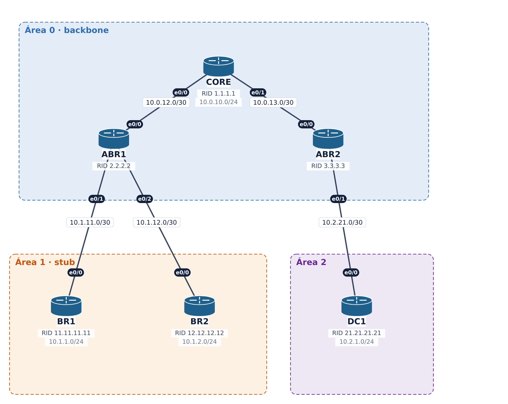

# Configurações IOS — Lab OSPF-A

Lab OSPF-A — Adjacência

Configurações completas de todos os nós, testadas no CML2 com IOL-XE 17.18. Para aplicar, use `configure terminal` e cole o bloco do nó.
Para EVE-NG, PNETLab ou GNS3, veja a tabela de interfaces em [`README.md`](README.md).



## Cabeamento

| Lado A | Lado B | IPv4 | IPv6 |
|---|---|---|---|
| CORE e0/0 | ABR1 e0/0 | 10.0.12.0/30 (área 0) | 2001:db8:acad:12::/64 |
| CORE e0/1 | ABR2 e0/0 | 10.0.13.0/30 (área 0) | 2001:db8:acad:13::/64 |
| ABR1 e0/1 | BR1 e0/0 | 10.1.11.0/30 (área 1) | 2001:db8:acad:111::/64 |
| ABR1 e0/2 | BR2 e0/0 | 10.1.12.0/30 (área 1) | 2001:db8:acad:112::/64 |
| ABR2 e0/1 | DC1 e0/0 | 10.2.21.0/30 (área 2) | 2001:db8:acad:221::/64 |

## Defeitos plantados

| Ticket | Problema | Onde |
|---|---|---|
| A1 | Hello/Dead diferentes | DC1 |
| A3 | MTU diferente | ABR1 |
| A2 | Área diferente no enlace | BR2 |
| A4 | Flag stub divergente | BR1 |

Índice: [Com problemas](#1-configurações-com-problemas) · [Solução](#2-configurações-da-solução)

## 1. Configurações com problemas

Cada defeito está marcado com `! >>>>> DEFEITO`.

### ABR1 (com problemas)

```
! ==========================================================
! Lab OSPF-A - ABR1 - COM OS DEFEITOS PLANTADOS (linhas '! >>>>> DEFEITO' indicam cada um)
! Plataforma testada: Cisco IOL-XE 17.18 (CML2). Interfaces Ethernet0/x.
! Uso: entre em 'configure terminal' e cole o bloco abaixo.
! ==========================================================
! --- Nome do equipamento
hostname ABR1
no ip domain lookup
! --- Habilita roteamento IPv6 (pilha dupla)
ipv6 unicast-routing
line con 0
 exec-timeout 0 0
 logging synchronous
! --- Loopback0: endereco de gerencia / identificacao
interface Loopback0
 ip ospf 1 area 0
 ip ospf network point-to-point
 ospfv3 network point-to-point
 ospfv3 1 ipv6 area 0
 ip address 10.255.255.2 255.255.255.255
 ipv6 address 2001:db8:acad:ffff::2/128
 no shutdown
interface Ethernet0/0
 description Link para CORE
 ip address 10.0.12.2 255.255.255.252
 ipv6 address 2001:db8:acad:012::2/64
 ip ospf 1 area 0
! >>>>> DEFEITO A3: MTU 1400 x 1500 no CORE -> EXSTART/EXCHANGE
 ip mtu 1400
 ospfv3 1 ipv6 area 0
 no shutdown
interface Ethernet0/1
 description Link para BR1
 ip address 10.1.11.1 255.255.255.252
 ipv6 address 2001:db8:acad:111::1/64
 ip ospf 1 area 1
 ospfv3 1 ipv6 area 1
 no shutdown
interface Ethernet0/2
 description Link para BR2
 ip address 10.1.12.1 255.255.255.252
 ipv6 address 2001:db8:acad:112::1/64
 ip ospf 1 area 1
 ospfv3 1 ipv6 area 1
 no shutdown
! --- OSPFv2 (IPv4)
router ospf 1
 router-id 2.2.2.2
 area 1 stub
! --- OSPFv3 com address-family (IPv6)
router ospfv3 1
 address-family ipv6 unicast
  router-id 2.2.2.2
  area 1 stub
 exit-address-family
end
```

### ABR2 (com problemas)

```
! ==========================================================
! Lab OSPF-A - ABR2 - COM OS DEFEITOS PLANTADOS (linhas '! >>>>> DEFEITO' indicam cada um)
! Plataforma testada: Cisco IOL-XE 17.18 (CML2). Interfaces Ethernet0/x.
! Uso: entre em 'configure terminal' e cole o bloco abaixo.
! ==========================================================
! --- Nome do equipamento
hostname ABR2
no ip domain lookup
! --- Habilita roteamento IPv6 (pilha dupla)
ipv6 unicast-routing
line con 0
 exec-timeout 0 0
 logging synchronous
! --- Loopback0: endereco de gerencia / identificacao
interface Loopback0
 ip ospf 1 area 0
 ip ospf network point-to-point
 ospfv3 network point-to-point
 ospfv3 1 ipv6 area 0
 ip address 10.255.255.3 255.255.255.255
 ipv6 address 2001:db8:acad:ffff::3/128
 no shutdown
interface Ethernet0/0
 description Link para CORE
 ip address 10.0.13.2 255.255.255.252
 ipv6 address 2001:db8:acad:013::2/64
 ip ospf 1 area 0
 ospfv3 1 ipv6 area 0
 no shutdown
interface Ethernet0/1
 description Link para DC1
 ip address 10.2.21.1 255.255.255.252
 ipv6 address 2001:db8:acad:221::1/64
 ip ospf 1 area 2
 ospfv3 1 ipv6 area 2
 no shutdown
! --- OSPFv2 (IPv4)
router ospf 1
 router-id 3.3.3.3
! --- OSPFv3 com address-family (IPv6)
router ospfv3 1
 address-family ipv6 unicast
  router-id 3.3.3.3
 exit-address-family
end
```

### BR1 (com problemas)

```
! ==========================================================
! Lab OSPF-A - BR1 - COM OS DEFEITOS PLANTADOS (linhas '! >>>>> DEFEITO' indicam cada um)
! Plataforma testada: Cisco IOL-XE 17.18 (CML2). Interfaces Ethernet0/x.
! Uso: entre em 'configure terminal' e cole o bloco abaixo.
! ==========================================================
! --- Nome do equipamento
hostname BR1
no ip domain lookup
! --- Habilita roteamento IPv6 (pilha dupla)
ipv6 unicast-routing
line con 0
 exec-timeout 0 0
 logging synchronous
! --- Loopback0: endereco de gerencia / identificacao
interface Loopback0
 ip ospf 1 area 1
 ip ospf network point-to-point
 ospfv3 network point-to-point
 ospfv3 1 ipv6 area 1
 ip address 10.255.255.4 255.255.255.255
 ipv6 address 2001:db8:acad:ffff::4/128
 no shutdown
! --- LAN simulada (loopback)
interface Loopback1
 ip address 10.1.1.1 255.255.255.0
 ipv6 address 2001:db8:acad:101::1/64
 ip ospf 1 area 1
 ip ospf network point-to-point
 ospfv3 network point-to-point
 ospfv3 1 ipv6 area 1
 no shutdown
interface Ethernet0/0
 description Link para ABR1
 ip address 10.1.11.2 255.255.255.252
 ipv6 address 2001:db8:acad:111::2/64
 ip ospf 1 area 1
 ospfv3 1 ipv6 area 1
 no shutdown
! --- OSPFv2 (IPv4)
! >>>>> DEFEITO A4: falta 'area 1 stub' no OSPFv2 (no OSPFv3 esta correto)
router ospf 1
 router-id 11.11.11.11
! --- OSPFv3 com address-family (IPv6)
router ospfv3 1
 address-family ipv6 unicast
  router-id 11.11.11.11
  area 1 stub
 exit-address-family
end
```

### BR2 (com problemas)

```
! ==========================================================
! Lab OSPF-A - BR2 - COM OS DEFEITOS PLANTADOS (linhas '! >>>>> DEFEITO' indicam cada um)
! Plataforma testada: Cisco IOL-XE 17.18 (CML2). Interfaces Ethernet0/x.
! Uso: entre em 'configure terminal' e cole o bloco abaixo.
! ==========================================================
! --- Nome do equipamento
hostname BR2
no ip domain lookup
! --- Habilita roteamento IPv6 (pilha dupla)
ipv6 unicast-routing
line con 0
 exec-timeout 0 0
 logging synchronous
! --- Loopback0: endereco de gerencia / identificacao
interface Loopback0
 ip ospf 1 area 1
 ip ospf network point-to-point
 ospfv3 network point-to-point
 ospfv3 1 ipv6 area 1
 ip address 10.255.255.5 255.255.255.255
 ipv6 address 2001:db8:acad:ffff::5/128
 no shutdown
! --- LAN simulada (loopback)
interface Loopback1
 ip address 10.1.2.1 255.255.255.0
 ipv6 address 2001:db8:acad:102::1/64
 ip ospf 1 area 1
 ip ospf network point-to-point
 ospfv3 network point-to-point
 ospfv3 1 ipv6 area 1
 no shutdown
interface Ethernet0/0
 description Link para ABR1
 ip address 10.1.12.2 255.255.255.252
 ipv6 address 2001:db8:acad:112::2/64
! >>>>> DEFEITO A2: enlace na area 0 (ABR1 usa area 1)
 ip ospf 1 area 0
 ospfv3 1 ipv6 area 1
 no shutdown
! --- OSPFv2 (IPv4)
router ospf 1
 router-id 12.12.12.12
 area 1 stub
! --- OSPFv3 com address-family (IPv6)
router ospfv3 1
 address-family ipv6 unicast
  router-id 12.12.12.12
  area 1 stub
 exit-address-family
end
```

### CORE (com problemas)

```
! ==========================================================
! Lab OSPF-A - CORE - COM OS DEFEITOS PLANTADOS (linhas '! >>>>> DEFEITO' indicam cada um)
! Plataforma testada: Cisco IOL-XE 17.18 (CML2). Interfaces Ethernet0/x.
! Uso: entre em 'configure terminal' e cole o bloco abaixo.
! ==========================================================
! --- Nome do equipamento
hostname CORE
no ip domain lookup
! --- Habilita roteamento IPv6 (pilha dupla)
ipv6 unicast-routing
line con 0
 exec-timeout 0 0
 logging synchronous
! --- Loopback0: endereco de gerencia / identificacao
interface Loopback0
 ip ospf 1 area 0
 ip ospf network point-to-point
 ospfv3 network point-to-point
 ospfv3 1 ipv6 area 0
 ip address 10.255.255.1 255.255.255.255
 ipv6 address 2001:db8:acad:ffff::1/128
 no shutdown
! --- LAN simulada (loopback)
interface Loopback1
 ip address 10.0.10.1 255.255.255.0
 ipv6 address 2001:db8:acad:010::1/64
 ip ospf 1 area 0
 ip ospf network point-to-point
 ospfv3 network point-to-point
 ospfv3 1 ipv6 area 0
 no shutdown
interface Ethernet0/0
 description Link para ABR1
 ip address 10.0.12.1 255.255.255.252
 ipv6 address 2001:db8:acad:012::1/64
 ip ospf 1 area 0
 ospfv3 1 ipv6 area 0
 no shutdown
interface Ethernet0/1
 description Link para ABR2
 ip address 10.0.13.1 255.255.255.252
 ipv6 address 2001:db8:acad:013::1/64
 ip ospf 1 area 0
 ospfv3 1 ipv6 area 0
 no shutdown
! --- OSPFv2 (IPv4)
router ospf 1
 router-id 1.1.1.1
! --- OSPFv3 com address-family (IPv6)
router ospfv3 1
 address-family ipv6 unicast
  router-id 1.1.1.1
 exit-address-family
end
```

### DC1 (com problemas)

```
! ==========================================================
! Lab OSPF-A - DC1 - COM OS DEFEITOS PLANTADOS (linhas '! >>>>> DEFEITO' indicam cada um)
! Plataforma testada: Cisco IOL-XE 17.18 (CML2). Interfaces Ethernet0/x.
! Uso: entre em 'configure terminal' e cole o bloco abaixo.
! ==========================================================
! --- Nome do equipamento
hostname DC1
no ip domain lookup
! --- Habilita roteamento IPv6 (pilha dupla)
ipv6 unicast-routing
line con 0
 exec-timeout 0 0
 logging synchronous
! --- Loopback0: endereco de gerencia / identificacao
interface Loopback0
 ip ospf 1 area 2
 ip ospf network point-to-point
 ospfv3 network point-to-point
 ospfv3 1 ipv6 area 2
 ip address 10.255.255.6 255.255.255.255
 ipv6 address 2001:db8:acad:ffff::6/128
 no shutdown
! --- LAN simulada (loopback)
interface Loopback1
 ip address 10.2.1.1 255.255.255.0
 ipv6 address 2001:db8:acad:201::1/64
 ip ospf 1 area 2
 ip ospf network point-to-point
 ospfv3 network point-to-point
 ospfv3 1 ipv6 area 2
 no shutdown
interface Ethernet0/0
 description Link para ABR2
 ip address 10.2.21.2 255.255.255.252
 ipv6 address 2001:db8:acad:221::2/64
 ip ospf 1 area 2
! >>>>> DEFEITO A1: hello 5 / dead 20 (ABR2 usa 10/40)
 ip ospf hello-interval 5
 ospfv3 1 ipv6 area 2
 no shutdown
! --- OSPFv2 (IPv4)
router ospf 1
 router-id 21.21.21.21
! --- OSPFv3 com address-family (IPv6)
router ospfv3 1
 address-family ipv6 unicast
  router-id 21.21.21.21
 exit-address-family
end
```

## 2. Configurações da solução

Todos os tickets corrigidos.

### ABR1 (solução)

```
! ==========================================================
! Lab OSPF-A - ABR1 - SOLUCAO - todos os tickets corrigidos
! Plataforma testada: Cisco IOL-XE 17.18 (CML2). Interfaces Ethernet0/x.
! Uso: entre em 'configure terminal' e cole o bloco abaixo.
! ==========================================================
hostname ABR1
no ip domain lookup
ipv6 unicast-routing
line con 0
 exec-timeout 0 0
 logging synchronous
interface Loopback0
 ip ospf 1 area 0
 ip ospf network point-to-point
 ospfv3 network point-to-point
 ospfv3 1 ipv6 area 0
 ip address 10.255.255.2 255.255.255.255
 ipv6 address 2001:db8:acad:ffff::2/128
 no shutdown
interface Ethernet0/0
 description Link para CORE
 ip address 10.0.12.2 255.255.255.252
 ipv6 address 2001:db8:acad:012::2/64
 ip ospf 1 area 0
 ospfv3 1 ipv6 area 0
 no shutdown
interface Ethernet0/1
 description Link para BR1
 ip address 10.1.11.1 255.255.255.252
 ipv6 address 2001:db8:acad:111::1/64
 ip ospf 1 area 1
 ospfv3 1 ipv6 area 1
 no shutdown
interface Ethernet0/2
 description Link para BR2
 ip address 10.1.12.1 255.255.255.252
 ipv6 address 2001:db8:acad:112::1/64
 ip ospf 1 area 1
 ospfv3 1 ipv6 area 1
 no shutdown
router ospf 1
 router-id 2.2.2.2
 area 1 stub
router ospfv3 1
 address-family ipv6 unicast
  router-id 2.2.2.2
  area 1 stub
 exit-address-family
end
```

### ABR2 (solução)

```
! ==========================================================
! Lab OSPF-A - ABR2 - SOLUCAO - todos os tickets corrigidos
! Plataforma testada: Cisco IOL-XE 17.18 (CML2). Interfaces Ethernet0/x.
! Uso: entre em 'configure terminal' e cole o bloco abaixo.
! ==========================================================
hostname ABR2
no ip domain lookup
ipv6 unicast-routing
line con 0
 exec-timeout 0 0
 logging synchronous
interface Loopback0
 ip ospf 1 area 0
 ip ospf network point-to-point
 ospfv3 network point-to-point
 ospfv3 1 ipv6 area 0
 ip address 10.255.255.3 255.255.255.255
 ipv6 address 2001:db8:acad:ffff::3/128
 no shutdown
interface Ethernet0/0
 description Link para CORE
 ip address 10.0.13.2 255.255.255.252
 ipv6 address 2001:db8:acad:013::2/64
 ip ospf 1 area 0
 ospfv3 1 ipv6 area 0
 no shutdown
interface Ethernet0/1
 description Link para DC1
 ip address 10.2.21.1 255.255.255.252
 ipv6 address 2001:db8:acad:221::1/64
 ip ospf 1 area 2
 ospfv3 1 ipv6 area 2
 no shutdown
router ospf 1
 router-id 3.3.3.3
router ospfv3 1
 address-family ipv6 unicast
  router-id 3.3.3.3
 exit-address-family
end
```

### BR1 (solução)

```
! ==========================================================
! Lab OSPF-A - BR1 - SOLUCAO - todos os tickets corrigidos
! Plataforma testada: Cisco IOL-XE 17.18 (CML2). Interfaces Ethernet0/x.
! Uso: entre em 'configure terminal' e cole o bloco abaixo.
! ==========================================================
hostname BR1
no ip domain lookup
ipv6 unicast-routing
line con 0
 exec-timeout 0 0
 logging synchronous
interface Loopback0
 ip ospf 1 area 1
 ip ospf network point-to-point
 ospfv3 network point-to-point
 ospfv3 1 ipv6 area 1
 ip address 10.255.255.4 255.255.255.255
 ipv6 address 2001:db8:acad:ffff::4/128
 no shutdown
interface Loopback1
 ip address 10.1.1.1 255.255.255.0
 ipv6 address 2001:db8:acad:101::1/64
 ip ospf 1 area 1
 ip ospf network point-to-point
 ospfv3 network point-to-point
 ospfv3 1 ipv6 area 1
 no shutdown
interface Ethernet0/0
 description Link para ABR1
 ip address 10.1.11.2 255.255.255.252
 ipv6 address 2001:db8:acad:111::2/64
 ip ospf 1 area 1
 ospfv3 1 ipv6 area 1
 no shutdown
router ospf 1
 router-id 11.11.11.11
 area 1 stub
router ospfv3 1
 address-family ipv6 unicast
  router-id 11.11.11.11
  area 1 stub
 exit-address-family
end
```

### BR2 (solução)

```
! ==========================================================
! Lab OSPF-A - BR2 - SOLUCAO - todos os tickets corrigidos
! Plataforma testada: Cisco IOL-XE 17.18 (CML2). Interfaces Ethernet0/x.
! Uso: entre em 'configure terminal' e cole o bloco abaixo.
! ==========================================================
hostname BR2
no ip domain lookup
ipv6 unicast-routing
line con 0
 exec-timeout 0 0
 logging synchronous
interface Loopback0
 ip ospf 1 area 1
 ip ospf network point-to-point
 ospfv3 network point-to-point
 ospfv3 1 ipv6 area 1
 ip address 10.255.255.5 255.255.255.255
 ipv6 address 2001:db8:acad:ffff::5/128
 no shutdown
interface Loopback1
 ip address 10.1.2.1 255.255.255.0
 ipv6 address 2001:db8:acad:102::1/64
 ip ospf 1 area 1
 ip ospf network point-to-point
 ospfv3 network point-to-point
 ospfv3 1 ipv6 area 1
 no shutdown
interface Ethernet0/0
 description Link para ABR1
 ip address 10.1.12.2 255.255.255.252
 ipv6 address 2001:db8:acad:112::2/64
 ip ospf 1 area 1
 ospfv3 1 ipv6 area 1
 no shutdown
router ospf 1
 router-id 12.12.12.12
 area 1 stub
router ospfv3 1
 address-family ipv6 unicast
  router-id 12.12.12.12
  area 1 stub
 exit-address-family
end
```

### CORE (solução)

```
! ==========================================================
! Lab OSPF-A - CORE - SOLUCAO - todos os tickets corrigidos
! Plataforma testada: Cisco IOL-XE 17.18 (CML2). Interfaces Ethernet0/x.
! Uso: entre em 'configure terminal' e cole o bloco abaixo.
! ==========================================================
hostname CORE
no ip domain lookup
ipv6 unicast-routing
line con 0
 exec-timeout 0 0
 logging synchronous
interface Loopback0
 ip ospf 1 area 0
 ip ospf network point-to-point
 ospfv3 network point-to-point
 ospfv3 1 ipv6 area 0
 ip address 10.255.255.1 255.255.255.255
 ipv6 address 2001:db8:acad:ffff::1/128
 no shutdown
interface Loopback1
 ip address 10.0.10.1 255.255.255.0
 ipv6 address 2001:db8:acad:010::1/64
 ip ospf 1 area 0
 ip ospf network point-to-point
 ospfv3 network point-to-point
 ospfv3 1 ipv6 area 0
 no shutdown
interface Ethernet0/0
 description Link para ABR1
 ip address 10.0.12.1 255.255.255.252
 ipv6 address 2001:db8:acad:012::1/64
 ip ospf 1 area 0
 ospfv3 1 ipv6 area 0
 no shutdown
interface Ethernet0/1
 description Link para ABR2
 ip address 10.0.13.1 255.255.255.252
 ipv6 address 2001:db8:acad:013::1/64
 ip ospf 1 area 0
 ospfv3 1 ipv6 area 0
 no shutdown
router ospf 1
 router-id 1.1.1.1
router ospfv3 1
 address-family ipv6 unicast
  router-id 1.1.1.1
 exit-address-family
end
```

### DC1 (solução)

```
! ==========================================================
! Lab OSPF-A - DC1 - SOLUCAO - todos os tickets corrigidos
! Plataforma testada: Cisco IOL-XE 17.18 (CML2). Interfaces Ethernet0/x.
! Uso: entre em 'configure terminal' e cole o bloco abaixo.
! ==========================================================
hostname DC1
no ip domain lookup
ipv6 unicast-routing
line con 0
 exec-timeout 0 0
 logging synchronous
interface Loopback0
 ip ospf 1 area 2
 ip ospf network point-to-point
 ospfv3 network point-to-point
 ospfv3 1 ipv6 area 2
 ip address 10.255.255.6 255.255.255.255
 ipv6 address 2001:db8:acad:ffff::6/128
 no shutdown
interface Loopback1
 ip address 10.2.1.1 255.255.255.0
 ipv6 address 2001:db8:acad:201::1/64
 ip ospf 1 area 2
 ip ospf network point-to-point
 ospfv3 network point-to-point
 ospfv3 1 ipv6 area 2
 no shutdown
interface Ethernet0/0
 description Link para ABR2
 ip address 10.2.21.2 255.255.255.252
 ipv6 address 2001:db8:acad:221::2/64
 ip ospf 1 area 2
 ospfv3 1 ipv6 area 2
 no shutdown
router ospf 1
 router-id 21.21.21.21
router ospfv3 1
 address-family ipv6 unicast
  router-id 21.21.21.21
 exit-address-family
end
```
